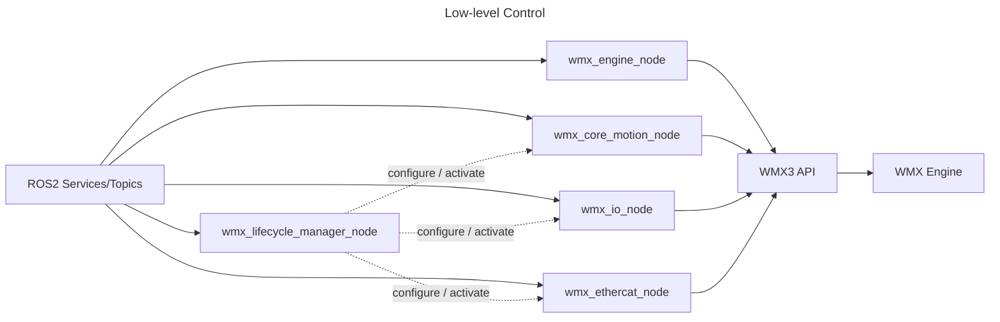
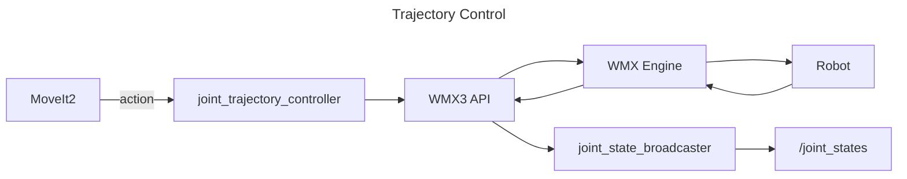

# WMX R2 Application

[](https://github.com/movensys/wmx-r2/actions/workflows/ci.yml)
[](https://docs.ros.org)
[](LICENSE.txt)
[](https://movensys.github.io/wmx-r2-doc/)

ROS2 interface for [WMX3](https://www.movensys.com/en/products/software_motion_control/wmx_en), a real-time EtherCAT motion control SDK by Movensys, enabling control of industrial robots and multi-axis systems from the ROS2 ecosystem.

This package wraps the WMX3 C++ API into standard ROS2 nodes, topics, services, and actions, so you can drive WMX3-controlled hardware (e.g. the Dobot CR3A/CR5A and Synustech DUCO GCR30-1100 manipulators) using MoveIt2, Nav2, or any ROS2-compatible planner without writing vendor-specific motion code.

## Features

- **Real-time motion:** deterministic multi-axis control over EtherCAT through the WMX3 engine.
- **ROS2 native:** exposes WMX3 as standard nodes, topics, services, and actions.
- **MoveIt2 / Nav2 ready:** trajectory execution and joint-state feedback with no vendor-specific motion code.
- **Full low-level access:** axis, IO, EtherCAT master, and engine control from the command line or your own nodes.
- **Dual distro:** supported and CI-tested on ROS2 **Humble** and **Jazzy**.
- **Hardware-proven:** ships configurations for the Dobot CR3A / CR5A and Synustech (DUCO GCR30-1100) manipulators and a differential-drive base.

## Requirements

> **Note:** This package controls real motion hardware and requires a real-time environment. It is not a simulator.

- **WMX Linux** (real-time patched) with the WMX3 SDK pre-installed (see [WMX installation](https://movensys.github.io/wmx-r2-doc/getting_started/install_wmx3.html)).
- EtherCAT-capable hardware (servo drives / IO reachable from the WMX3 master).
- ROS2 **Humble** or **Jazzy**.
- `rmw_cyclonedds` as the RMW implementation.
- Manipulator launches require **root** (real-time scheduling), started via `sudo --preserve-env`.

## Quickstart

Full environment setup, dependencies, and `~/.bashrc` configuration are in [doc/first_setup.md](doc/first_setup.md).

```bash
# 1. Build (messages first, then the rest)
cd ~/workspaces/movensys_ws
colcon build --packages-select wmx_ros2_message
source install/setup.bash
colcon build && source install/setup.bash

# 2. Launch the low-level nodes (engine, lifecycle manager, core motion, IO, EtherCAT)
ros2 launch wmx_ros2_package wmx_ros2_general_nodes.launch.py

# 3. Bring axes online and command a move
ros2 service call /wmx/axes/set_servo_on wmx_ros2_message/srv/SetAxes "{indices: [0,1], data: [1,1]}"
ros2 topic pub --once /wmx/axes/start_pos wmx_ros2_message/msg/AxesPose \
  "{indices: [0,1], positions: [8388608, 10000], velocities: [1000000, 5000], accelerations: [100000, 1000], decelerations: [100000, 1000]}"
```

The full startup sequence and the complete service/topic catalog are documented in
[doc/reference_wmx_r2_general_nodes.md](doc/reference_wmx_r2_general_nodes.md).

## Architecture

### Low-level Control ([wmx_r2_general_nodes.launch.py](wmx_r2_package/launch/wmx_r2_general_nodes.launch.py))



### Trajectory Control ([wmx_r2_cr3a_manipulator.launch.py](wmx_r2_package/launch/wmx_r2_cr3a_manipulator.launch.py))



- `MoveIt2` -> `joint_trajectory_controller` -> WMX3 API -> WMX Engine -> Robot
- Robot -> WMX Engine -> WMX3 API -> `joint_state_broadcaster` -> `/joint_states`

## Packages

| Package | Description |
|---------|-------------|
| [wmx_r2_message](wmx_r2_message/) | Custom messages and services for axis, IO, EtherCAT, and engine control |
| [wmx_r2_package](wmx_r2_package/) | Main nodes, launch files, and robot configurations |

## Nodes

| Node | Role |
|------|------|
| `wmx_engine_node` | Engine and device initialization, overall state management |
| `wmx_lifecycle_manager_node` | Discovers the managed lifecycle nodes and drives them up once the engine is communicating, down when it stops |
| `wmx_core_motion_node` | Core motion control and trajectory execution |
| `wmx_io_node` | IO control for input/output bits and bytes |
| `wmx_ethercat_node` | EtherCAT master operations and slave management |
| `joint_trajectory_controller` | Receives trajectory actions and executes via WMX3 C-Spline |
| `joint_position_controller` | Follows MoveIt Servo's streamed `JointTrajectory` via WMX3 linear interpolation, so every axis arrives at the same instant |
| `joint_state_broadcaster` | Publishes joint feedback from the WMX3 encoder to `/joint_states` |
| `gripper_controller` | Gripper command handling for manipulators |

## Launch Files

| Launch file | Purpose | Nodes started |
|-------------|---------|---------------|
| [wmx_r2_general_nodes.launch.py](wmx_r2_package/launch/wmx_r2_general_nodes.launch.py) | Low-level axis / IO / EtherCAT control | `wmx_engine_node`, `wmx_lifecycle_manager_node`, `wmx_core_motion_node`, `wmx_io_node`, `wmx_ethercat_node` |
| [wmx_r2_cr3a_manipulator.launch.py](wmx_r2_package/launch/wmx_r2_cr3a_manipulator.launch.py) | Dobot CR3A trajectory control | general nodes + `joint_state_broadcaster`, `joint_trajectory_controller`, `joint_position_controller`, `gripper_controller` |
| [wmx_r2_cr5a_manipulator.launch.py](wmx_r2_package/launch/wmx_r2_cr5a_manipulator.launch.py) | Dobot CR5A trajectory control | general nodes + `joint_state_broadcaster`, `joint_trajectory_controller` |
| [wmx_r2_synustech_manipulator.launch.py](wmx_r2_package/launch/wmx_r2_synustech_manipulator.launch.py) | Synustech (DUCO GCR30-1100) trajectory control, arm on WMX axes 2-7 | general nodes + `joint_state_broadcaster`, `joint_trajectory_controller`, `joint_position_controller` or `servo_stream_controller` |

## Supported Robots

| Robot | Type | Launch file | WMX parameters | Guide |
|-------|------|-------------|----------------|-------|
| Dobot CR3A | 6-axis manipulator | `wmx_ros2_cr3a_manipulator.launch.py` | `config/cr3a_wmx_parameters.xml` | [doc/launch_dobot_cr3a_manipulator.md](doc/launch_dobot_cr3a_manipulator.md) |
| Dobot CR5A | 6-axis manipulator | `wmx_ros2_cr5a_manipulator.launch.py` | `config/cr5a_wmx_parameters.xml` | [doc/launch_dobot_cr5a_manipulator.md](doc/launch_dobot_cr5a_manipulator.md) |
| Synustech (DUCO GCR30-1100) | 6-axis manipulator on a mobile base, arm on axes 2-7 | `wmx_r2_synustech_manipulator.launch.py` | `config/synustech_wmx_parameters.xml` | [doc/launch_synustech_manipulator.md](doc/launch_synustech_manipulator.md) |
| Diffbot | Differential-drive base | `wmx_ros2_general_nodes.launch.py` | `config/diffbot_wmx_parameters.xml` | [doc/launch_wmx_r2_general_nodes.md](doc/launch_wmx_r2_general_nodes.md) |

## MoveIt2 Integration

To connect with `movensys-manipulator`, change the action name in `config/cr3a_manipulator_config.yaml`:

```yaml
joint_trajectory_action: /movensys_manipulator_arm_controller/follow_joint_trajectory
```

## Documentation

To quickly set up the WMX ROS2 package and explore its key features, follow these steps:

| Doc | Description |
|-----|-------------|
| [doc/first_setup.md](doc/first_setup.md) | Environment setup, dependencies, build |
| [doc/launch_wmx_r2_general_nodes.md](doc/launch_wmx_r2_general_nodes.md) | Launch the WMX general nodes |
| [doc/launch_dobot_cr3a_manipulator.md](doc/launch_dobot_cr3a_manipulator.md) | Launch the Dobot CR3A manipulator |
| [doc/launch_dobot_cr5a_manipulator.md](doc/launch_dobot_cr5a_manipulator.md) | Launch the Dobot CR5A manipulator |
| [doc/launch_synustech_manipulator.md](doc/launch_synustech_manipulator.md) | Launch the Synustech (DUCO GCR30-1100) manipulator |
| [doc/launch_single_servo_streamer.md](doc/launch_single_servo_streamer.md) | Bring up and test the buffered Servo streamer on a single axis |
| [doc/launch_dobot_cr3a_manipulator_streamer.md](doc/launch_dobot_cr3a_manipulator_streamer.md) | Run the CR3A with MoveIt Servo through the API buffer |
| [doc/reference_wmx_r2_general_nodes.md](doc/reference_wmx_r2_general_nodes.md) | ROS2 service/topic reference with startup sequence |
| [doc/reference_servo_stream_controller.md](doc/reference_servo_stream_controller.md) | Buffered MoveIt Servo streaming path: what it is and how to run it |
| [doc/system_test.md](doc/system_test.md) | System-level test procedures |

For the complete and up-to-date documentation, please visit the official site:
**[WMX R2 Documentation](https://movensys.github.io/wmx-r2-doc/)**

## Roadmap

- [x] Low-level axis, IO, and EtherCAT control nodes
- [x] Trajectory control for Dobot CR3A / CR5A and Synustech (DUCO GCR30-1100)
- [x] MoveIt2 integration
- [x] CI on ROS2 Humble and Jazzy (lint + message build/test)
- [ ] Nav2 integration example for mobile bases

## Demo Videos

### Physical AI powered by WMX ROS2 on NVIDIA Jetson Thor
[](https://www.youtube.com/watch?v=h-G9vtAGAIU)

## License

This project is released under the [MIT License](LICENSE.txt).
